# Gleaner

A website-scraping platform for building scrapers, running them on a schedule, tracking every change in the data, and getting alerted when something matters. It's built to collect data responsibly: approved sites only, robots.txt always obeyed, polite rate limits, and an honest crawler identity.

## Screenshots

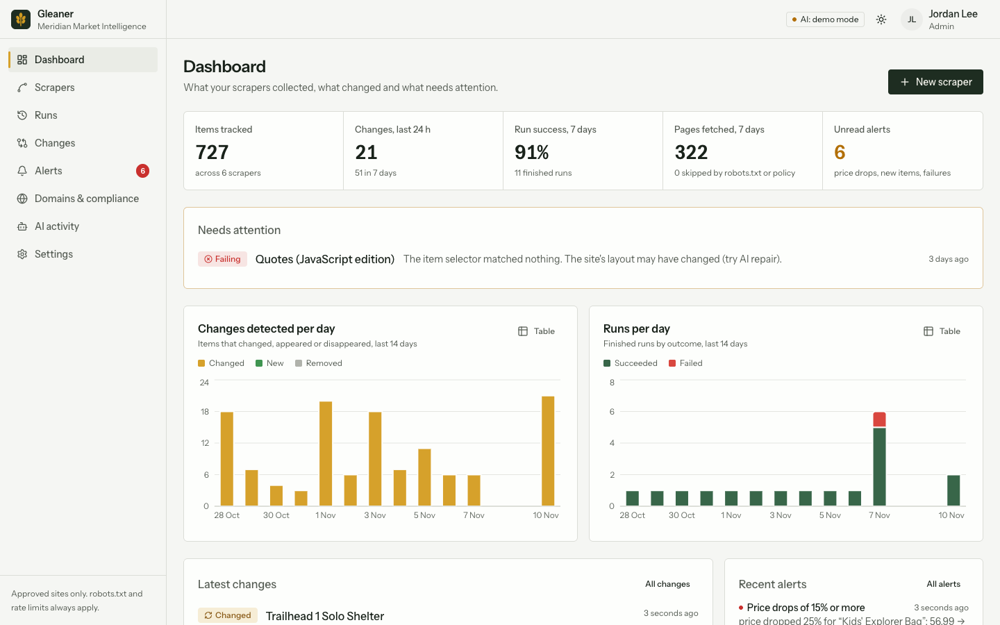

| | |
|---|---|
| 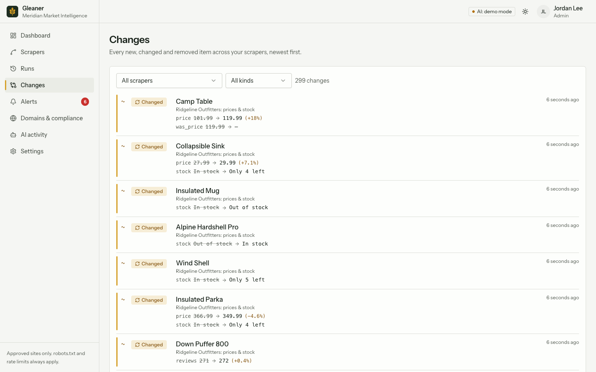<br><sub>Change feed</sub> | 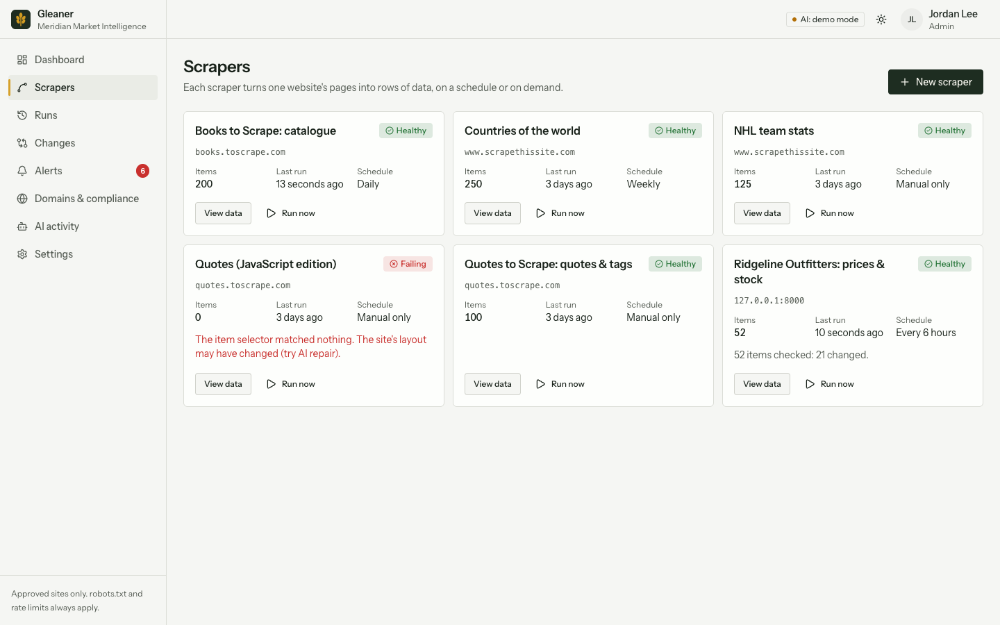<br><sub>Scrapers</sub> |
| 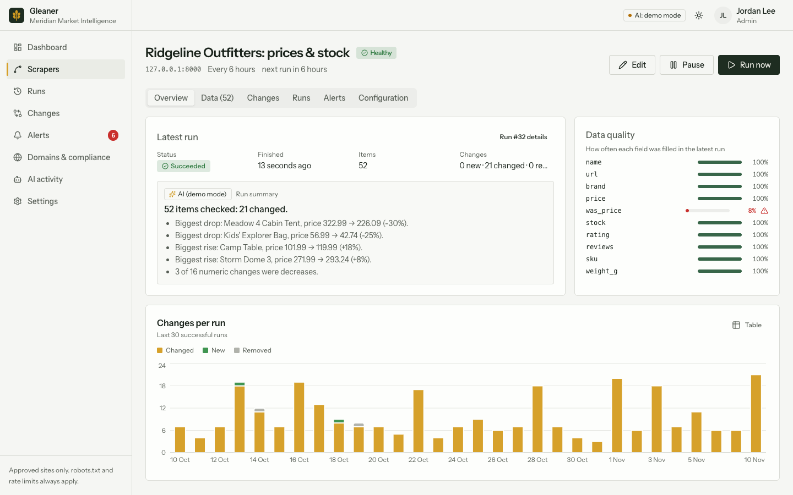<br><sub>Scraper overview</sub> | 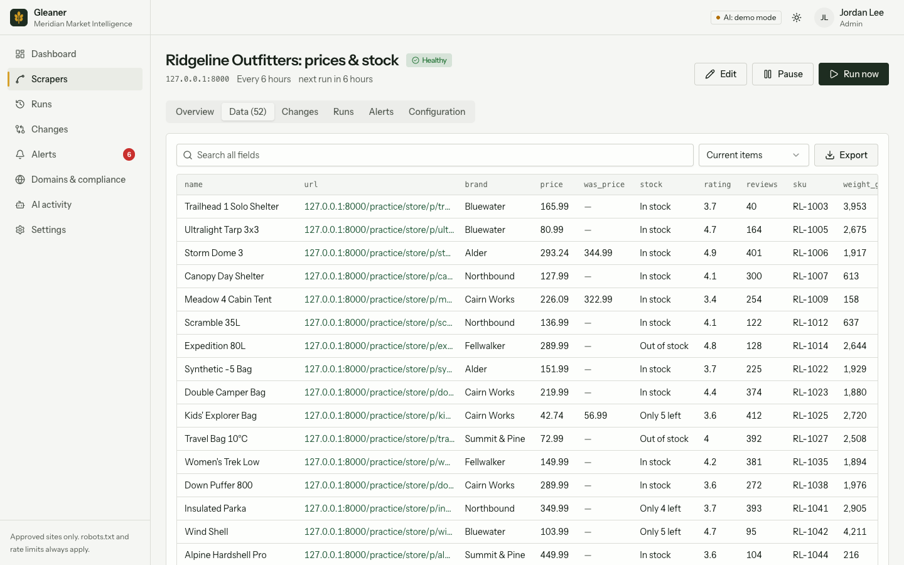<br><sub>Collected data</sub> |
| 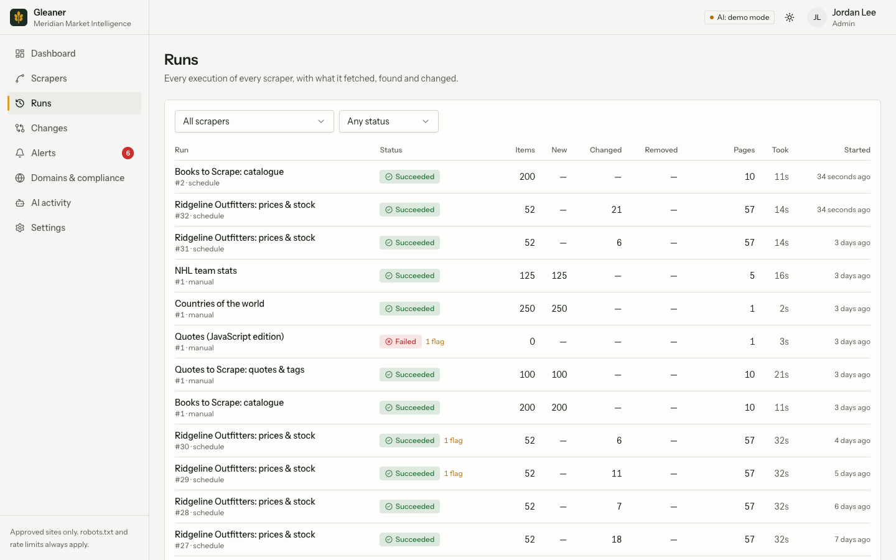<br><sub>Runs</sub> | 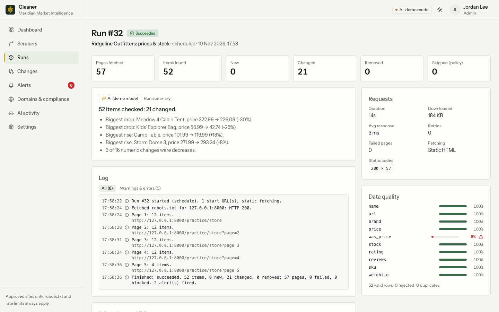<br><sub>Run detail</sub> |
| 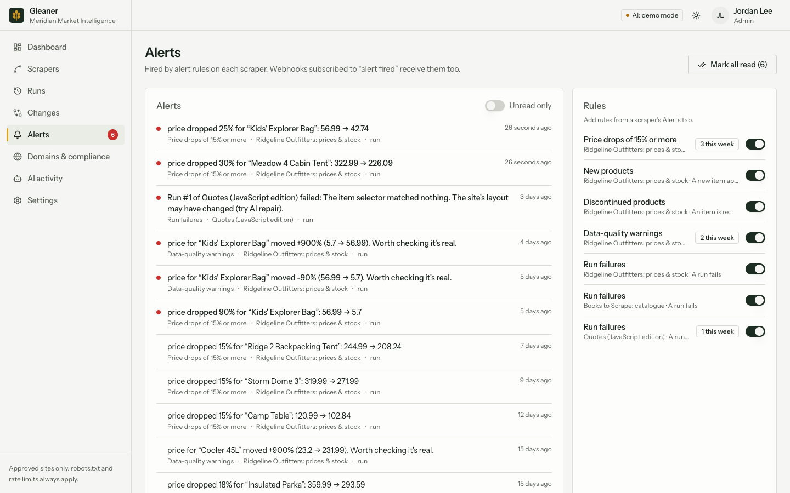<br><sub>Alerts</sub> | 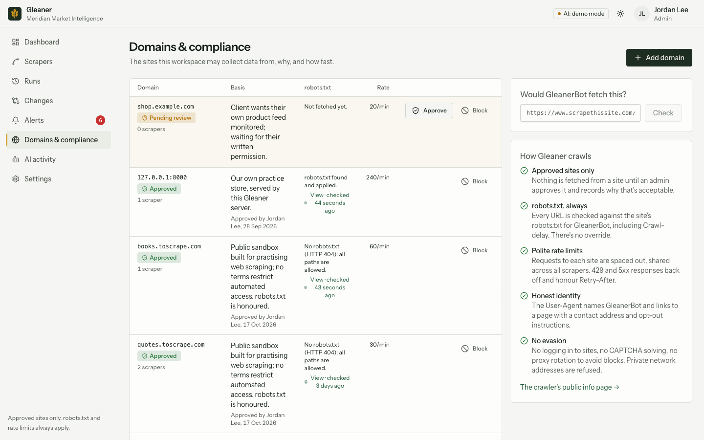<br><sub>Domains and compliance</sub> |
| 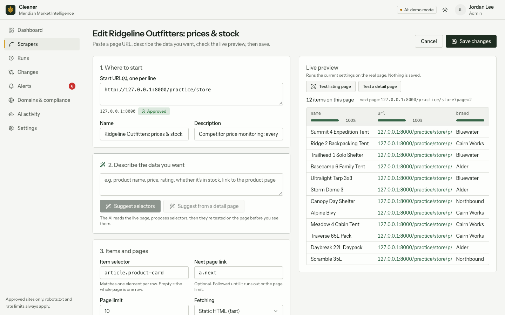<br><sub>Scraper editor with live preview</sub> | 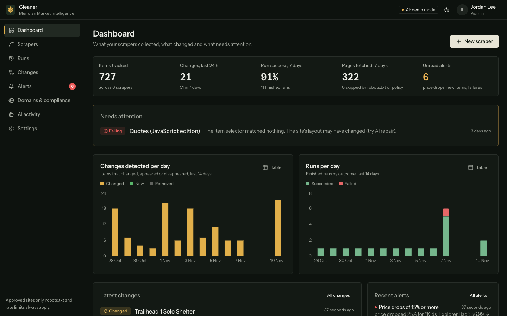<br><sub>Dark mode</sub> |
| 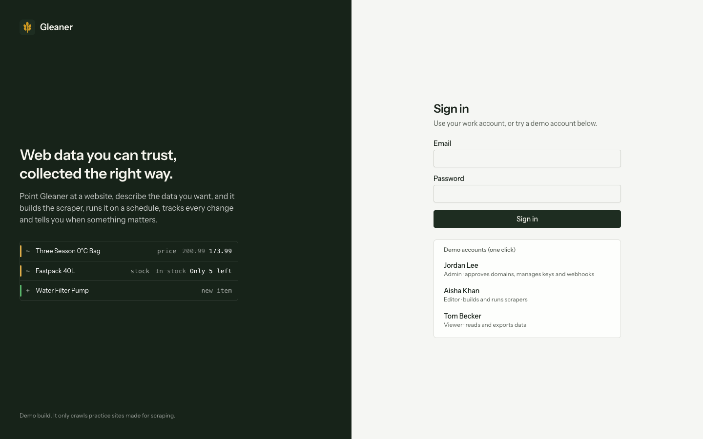<br><sub>Sign in</sub> |  |

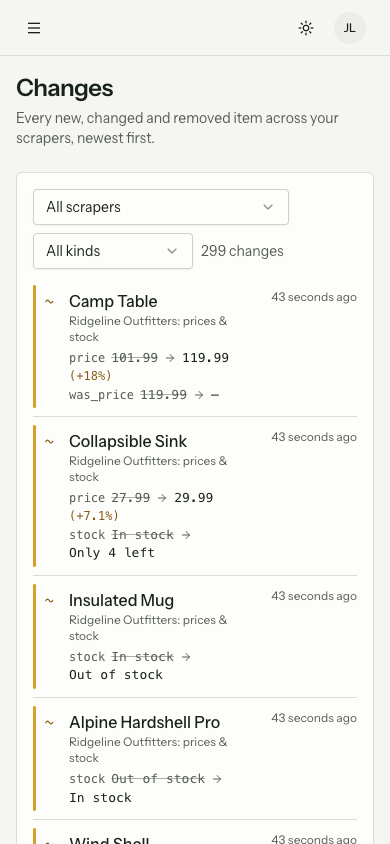

Screenshots use demo or dummy data.


## Features

**Scraping**
- **Scraper builder:** CSS selectors for the items, fields, pagination and detail pages, with a live preview against the real page.
  - **Field types:** text, number, price (currency and thousands separators handled), URL, yes/no and lists.
  - **Cleanup:** optional regex and value maps per field.
- **Fetching:** static HTML, or a headless Chromium browser (Playwright) for sites built with JavaScript.
- **Reliability:**
  - Retries with exponential backoff, honouring `Retry-After`.
  - Size limits, plus redirect hops that are each checked against policy.
- **Scheduling:** scheduled runs (hourly to weekly) through a built-in worker, with live run progress, a log, and cancellation.

**Data and change tracking**
- **Change tracking:** every item is matched across runs by key fields.
  - Each new, changed, removed and returning item is recorded with field-level diffs.
  - Value history charts, such as price over time, show for each item.
- **Removal detection:** this only happens on complete runs, so one failed page can't make items look deleted.
- **First run as baseline:** a scraper's first run records a baseline, so the feeds and alerts aren't flooded.
- **Data-quality checks** after every run:
  - fill rate per field, and rejected rows;
  - broken selectors;
  - drops in item count or fill rate;
  - implausible value jumps, such as a pricing error;
  - mass removals.
- **Alerts:** field changes (for example "price drops 15% or more"), new items, removals, failed runs and data-quality flags.
- **Exports and integrations:**
  - CSV, Excel and JSON exports.
  - A read API authenticated with API keys (`/api/v1`).
  - HMAC-signed webhooks for finished runs and fired alerts.

**AI (a local LLM, with an offline rule-based fallback)**
- **Selector assistant:** describe the fields in plain English. The model proposes selectors, the real extractor tests them on the live page, and it gets one correction round if fields come back empty.
- **AI repair:** for scrapers that broke, it first checks whether the page now just needs browser rendering, and otherwise proposes new selectors that keep the same field names.
- **Run summaries:** what changed, in plain English, with anything that looks wrong flagged.
- **AI activity log:** every prompt, response, model, latency and token count.

**Compliance**
- **Domains:**
  - Each domain is pending, approved or blocked. An admin records why scraping it is acceptable, and sets a per-site rate limit.
  - A domain's limit is shared by every scraper on that site.
- **robots.txt (RFC 9309):** `Crawl-delay` is applied. A missing robots.txt allows everything; one that can't be reached blocks everything until it can be read.
- **Honest identity:** the User-Agent names GleanerBot and includes a contact email. The `/bot` page explains how site owners can opt out.
- **SSRF protection:** private, loopback and link-local addresses are refused, for crawling, robots.txt and webhooks alike.
- **Roles:**
  - Admins approve domains and manage the team, keys and webhooks.
  - Editors build and run scrapers.
  - Viewers read and export.

## Demo data

`seed.py` creates a workspace with three users (password `Gleaner!2026`) and six scrapers:

| Scraper | Site | Shows |
|---|---|---|
| Ridgeline Outfitters: prices & stock | Built-in practice store served by this backend | 30 days of price, stock and catalogue changes, detail pages, alerts, and a pricing glitch caught by the checks |
| Books to Scrape | books.toscrape.com | Pagination, star ratings mapped to numbers |
| Quotes to Scrape | quotes.toscrape.com | Lists (tags) |
| Quotes (JavaScript edition) | quotes.toscrape.com/js | A failing scraper; AI repair switches it to browser rendering |
| Countries of the world | scrapethissite.com | 250 rows from one page |
| NHL team stats | scrapethissite.com | A table with pagination and composite keys |

The public sites are sandboxes made for scraping practice. The practice store is fictional, and its prices change every day based on the date, so change tracking has real data to work with.

- **How the history is built:** the store's history replays each past day through the real extractor and ingest code.
- **Live runs:** the other scrapers each get one real run when you seed. Use `SEED_LIVE=0` to skip them when offline.

## Running it

### With Docker (recommended)

Needs only Docker Desktop (or Docker Engine with Compose v2).

```bash
docker compose up -d --build       # first start seeds the demo data (about a minute)
# open http://localhost:8080 and sign in as admin@meridian.demo / Gleaner!2026
```

- **Secrets:** read from `backend/.env` if it exists (`JWT_SECRET`, `LOCAL_LLM_MODEL`). It's optional. AI uses a local model through Ollama; see [Local AI model](#local-ai-model). The Docker setup overrides the `.env` port and database settings itself.
- **Port:** change it with `GLEANER_PORT=9000 docker compose up -d`.
- **Data:** kept in the `gleaner-data` Docker volume, separate on each machine. To re-seed: `docker compose run --rm backend python seed.py`. To wipe: `docker compose down -v`.
- **Browser rendering:** the backend image includes Chromium, so JavaScript sites work out of the box.
- **Logs:** `docker compose logs -f backend`.
- **Live reload while editing:** `docker compose -f docker-compose.dev.yml up --build`, then open http://localhost:5180. Code changes on either machine reload the running app. The frontend's `node_modules` lives in a Docker volume and is reinstalled only when `package-lock.json` changes. It uses the same `gleaner-data` volume.
- **After syncing an update:** `docker compose up -d --build` rebuilds only what changed.

### Without Docker

```bash
# Backend
cd backend
python -m venv .venv && source .venv/bin/activate   # Windows: .venv\Scripts\activate
pip install -r requirements.txt
playwright install chromium        # optional, for JavaScript sites
cp .env.example .env               # set JWT_SECRET; PUBLIC_BASE_URL must match the port below
python seed.py
uvicorn app.main:app --reload --port 8000

# Frontend
cd frontend
npm install
npm run dev                        # http://localhost:5173 (set API_URL if the backend isn't on 8000)
```

- **AI:** install Ollama and download a model; see [Local AI model](#local-ai-model). Without it, the AI features run in offline demo mode.
- **Tests:** `cd backend && pytest`. 33 tests cover the crawl pipeline against the practice store in-process, robots.txt, domain policy, SSRF, change tracking, alerts, roles, exports, API keys, webhook signatures and the local model client.

## Local AI model

The AI features run on a local LLM served by [Ollama](https://ollama.com), so nothing leaves
the machine and there's no per-call cost.

1. Install Ollama, then download a model once:
   `ollama pull qwen2.5:7b-instruct-q4_K_M`
   With 12 GB or more of GPU memory, `qwen2.5:14b-instruct-q4_K_M` gives noticeably better results.
2. If you use a model other than the default, set `LOCAL_LLM_MODEL` in `backend/.env`.

Each feature's answer is constrained to its JSON schema, so the model can only return data of
the right shape. Ollama runs outside Docker so it can use the GPU; the containers reach it at
`host.docker.internal`. If Ollama isn't running or the model isn't downloaded, the AI features
run in **demo mode** (rule-based), and the top bar shows which mode is active.

Settings: `AI_PROVIDER` (`auto`, `local` or `demo`), `LOCAL_LLM_URL`, `LOCAL_LLM_MODEL` and
`LOCAL_LLM_CONTEXT` (the context window in tokens, 20480 by default).

## Stack

- **Backend:** FastAPI, SQLAlchemy 2 (SQLite, or Postgres via `DATABASE_URL`), httpx, parsel/lxml, Playwright, openpyxl, and a local LLM through Ollama for the AI features.
- **Frontend:** React 19, TypeScript, Vite, Tailwind CSS v4, TanStack Query, Recharts.
- **Worker:** the scheduler runs on a background thread in the API process by default. Set `RUN_WORKER=false` and run `python -m app.worker` to scale it separately.
